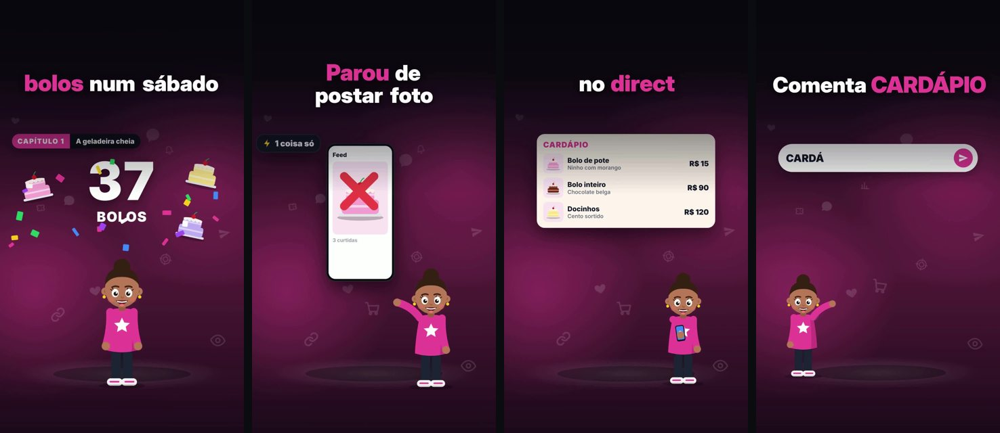

# Vídeos animados narrados (skill para Claude Code e Codex)

Criado por [@brnrmedeiros](https://instagram.com/brnrmedeiros).

Uma skill que transforma o teu nicho numa novela animada para Reels e TikTok: personagens fixos, uma voz narrando, telas e objetos mudando a cada frase, legenda sincronizada com a palavra falada e um CTA de comentário no fim. Tu não aparece na câmera.



## O que ela faz

- **Questionário:** pergunta teu nicho, teu público, o que tu entrega no direct e como são teus personagens, e desenha o elenco pra tu aprovar.
- **Roteiro:** escreve cada capítulo em AIDA, com gancho nos 3 primeiros segundos, termo técnico traduzido por um personagem e CTA "Comenta PALAVRA, que eu te mando no direct".
- **Cenas:** anima cada frase com os personagens e com telas de celular, notebook, chat, números, gráficos e objetos, tudo entrando na palavra falada.
- **Voz:** usa a tua voz gravada, ElevenLabs, OpenAI ou uma voz grátis no computador, sempre numa gravação só.
- **Conferência:** confere se a narração tem o texto do roteiro, se ficou toda em português e se a voz não mudou no meio, e corta as pausas mortas.
- **Exportação:** gera o MP4 no padrão do Reels (1080x1920, 30 fps, H.264, AAC 48 kHz) e valida o arquivo.

## Instalar

Precisa de um Mac ou Linux com Python 3.10+, e do Claude Code ou do Codex. No Windows, use o WSL (Ubuntu).

### Pelo próprio Claude Code ou Codex (sem terminal)

Cole este pedido no Claude Code ou no Codex:

```
Instala pra mim a skill "videos-animados" deste repositório: https://github.com/bnmedeiros1/videos-animados
1. Se a pasta ~/videos-animados-skill já existe, entra nela e roda git pull. Se não existe, clona o repositório em ~/videos-animados-skill.
2. Roda: bash ~/videos-animados-skill/install.sh
   (se eu quiser a voz grátis no computador, roda com --voz-gratis)
3. O instalador baixa uns 700 MB de modelos de fala (mais 120 MB com a voz grátis), uma vez só. Me avisa quando terminar e me diz pra fechar e abrir de novo o Claude Code e o Codex.
Me explica em português simples o que está fazendo e não mexe em outras skills.
```

### Pelo terminal

```bash
git clone https://github.com/bnmedeiros1/videos-animados.git ~/videos-animados-skill
bash ~/videos-animados-skill/install.sh            # ou: bash ~/videos-animados-skill/install.sh --voz-gratis
```

O `install.sh` liga a skill nos dois lugares:

- Claude Code → `~/.claude/skills/videos-animados`
- Codex → `~/.agents/skills/videos-animados`

e instala o motor em `~/.videos-animados` (ambiente Python, navegador de render e modelos). Não apague a pasta `~/videos-animados-skill`: a skill instalada aponta pra ela.

Atualizar: `cd ~/videos-animados-skill && git pull`.

## Usar

Abra o Claude Code (ou o Codex) numa pasta vazia e peça:

- `quero criar meus vídeos animados` (primeira vez: começa pelo questionário)
- `escreve o capítulo 2 da novela`
- `faz um anúncio animado sobre o meu curso`
- `refaz a cena 7 com a Dona Neide no centro`

No Claude Code dá pra chamar direto com `/videos-animados`; no Codex, com `$videos-animados`.

Teus vídeos ficam em `videos-animados/prontos/`.

## Voz

| Caminho | Custo | Como |
|---|---|---|
| Tua voz | grátis | grava o texto no celular, numa tacada só, e manda o arquivo |
| ElevenLabs | pago | chave na variável `ELEVENLABS_API_KEY` e o ID da voz no perfil |
| OpenAI | pago | chave na variável `OPENAI_API_KEY` |
| Voz grátis (Kokoro) | grátis | `install.sh --voz-gratis`; boa para testar, sintética para publicar |
| Outro gerador | depende | gera o texto inteiro numa geração só e manda o arquivo |

## Exemplo

A pasta `skills/videos-animados/exemplo/` tem um projeto pronto (uma confeitaria fictícia, três personagens e o capítulo 1). Para ver o motor funcionando:

```bash
cd ~/videos-animados-skill/skills/videos-animados
python3 motor/video.py elenco exemplo
python3 motor/video.py voz exemplo/episodios/01-a-primeira-encomenda      # precisa da voz grátis
python3 motor/video.py tudo exemplo/episodios/01-a-primeira-encomenda
```

O vídeo sai em `exemplo/prontos/`.

## Créditos e licenças

- Código desta skill: licença MIT (arquivo `LICENSE`).
- Fonte Inter (embutida): SIL Open Font License 1.1, The Inter Project Authors (`skills/videos-animados/motor/fontes/OFL.txt`).
- Baixados na instalação, não incluídos aqui: Parakeet TDT 0.6B v3 da NVIDIA (CC-BY-4.0) e Whisper base da OpenAI (MIT), convertidos pelo projeto sherpa-onnx (Apache-2.0); WeSpeaker ResNet34 (Apache-2.0); Kokoro-82M (Apache-2.0); Playwright (Apache-2.0).
